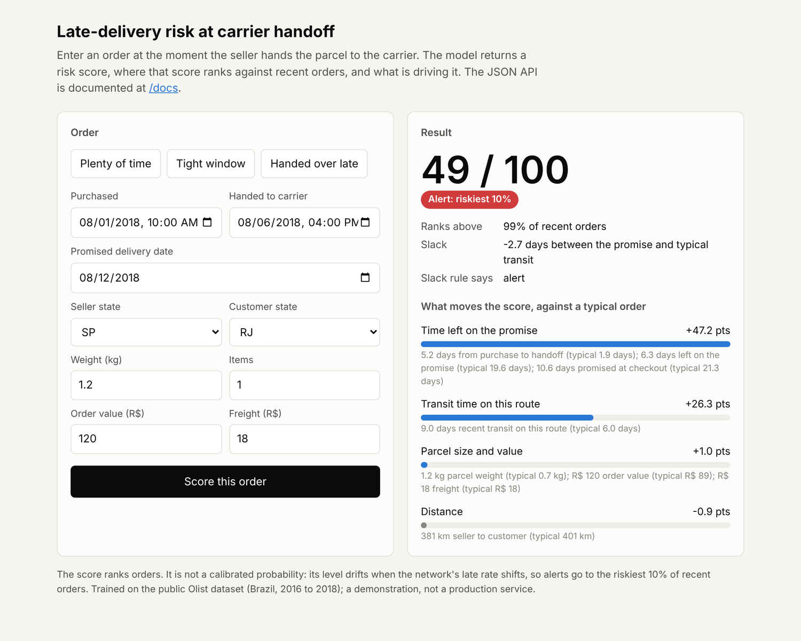
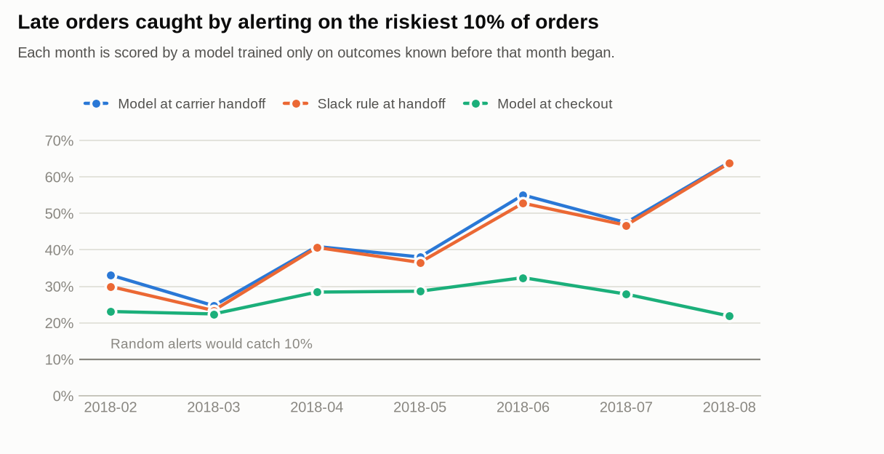
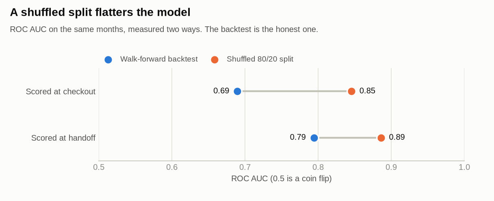
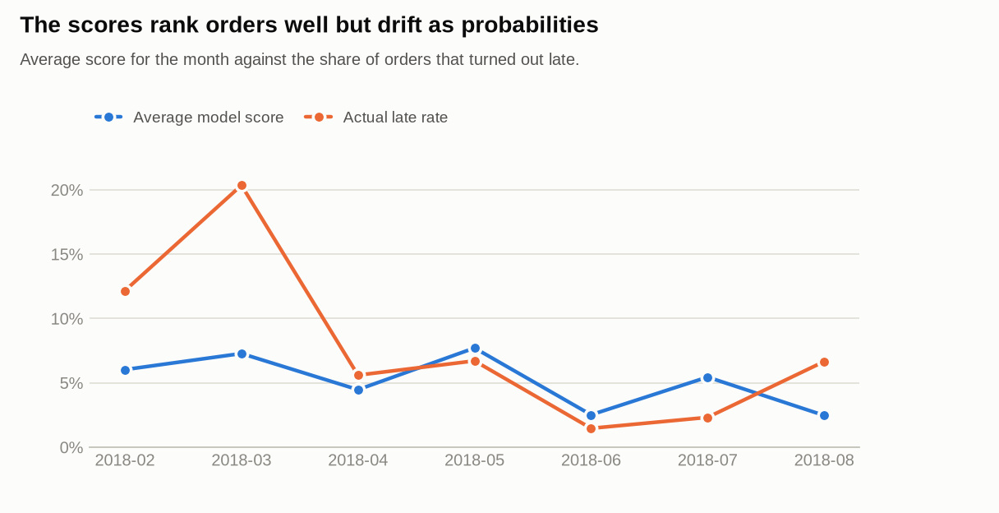

# Late-delivery risk

An early-warning model for e-commerce orders. It scores each order at the moment the seller hands the parcel to the carrier, so a support or logistics team can act on the riskiest orders before the customer notices a delay.

In a month-by-month backtest on 46,431 orders from the public Olist dataset, alerting on the riskiest 10% of orders caught 36% of the deliveries that ended up late. Random alerts would catch 10%.



<!-- After deploying, replace this comment with: **Live demo:** https://huggingface.co/spaces/YOUR_NAME/late-delivery-risk -->

## Results

The evaluation covers orders handed to the carrier from February to August 2018: 46,431 orders, 3,770 of them late (8.1%). Each month has its own model, trained only on orders whose outcome was already known when that month began. Alerts go to the riskiest 10% of each month's orders, 4,644 alerts in total.

| Scored | Method | Late orders caught | Alerts that were late | Average precision | ROC AUC |
| --- | --- | ---: | ---: | ---: | ---: |
| | Random alerts | 10.0% | 8.1% | 0.081 | 0.500 |
| At checkout | Gradient boosting | 24.3% | 19.5% | 0.148 | 0.690 |
| At checkout | Logistic regression | 26.9% | 21.6% | 0.208 | 0.753 |
| At carrier handoff | Slack rule (one line) | 34.7% | 28.2% | 0.315 | 0.741 |
| At carrier handoff | Logistic regression | 35.2% | 28.6% | 0.324 | 0.801 |
| At carrier handoff | **Gradient boosting (served)** | **36.2%** | **29.4%** | **0.344** | 0.794 |

The checkout rows cover the 45,708 orders purchased in the same months. Every number comes from `reports/metrics.json`, which the pipeline rewrites on each run.

In counts: the served model's alerts contained 1,365 of the 3,770 late orders. The slack rule's contained 1,309.



### 1. The scoring moment matters more than the model

At checkout the best of three methods caught 27% of late orders. At carrier handoff a one-line rule caught 35%. By handoff the seller's handling time is known, and it decides how much of the promised window is left for the carrier.

### 2. One feature carries the model

Slack is the number of days left on the promise at handoff, minus the average transit time of parcels delivered on the same route (seller state to customer state) in the previous 60 days. Sorting orders by slack alone, with no model, catches 34.7% of late orders.

The boosted model adds 1.5 points on top: 56 more late orders over seven months for the same number of alerts. It beat the rule on recall in all seven months and on average precision in six. A paired bootstrap over orders (1,000 resamples) puts the 95% interval for that lead at 0.4 to 2.4 points. Permutation importance on the last month puts slack at 0.42, days left on the promise at 0.20, handling time at 0.02, and every other input under 0.01.

A team that wanted the cheapest useful version of this project could ship the slack rule as a SQL column. [`sql/slack_rule.sql`](sql/slack_rule.sql) is that query: two window functions over a stream of delivery and handoff events. On the full dataset it agrees with the Python feature for all 96,469 orders, and its alerts catch the same 1,309 late orders.

### 3. A shuffled split would have reported AUC 0.89

The same model, trained on a random 80% of all orders and scored on the held-out orders from the same months, reports AUC 0.886 and 53% of late orders caught. The walk-forward backtest reports 0.794 and 36%. A random split puts orders from the same days on both sides, and the network inputs then tell the model which days went badly.



### 4. The scores rank orders well, but their level does not hold

In March 2018 the model's average score was 7.3% and 20.3% of orders were late. In June the average score was 2.5% and 1.5% were late. Lateness arrives in bursts, and every input that describes the network looks backwards. For that reason alerts go to the top 10% by rank, and the API labels its score as a ranking score.



### 5. The drift check caught a change in the source data

From January to April 2018, between 53% and 65% of carrier scans were stamped between 18:00 and midnight. From May on, about 3% were. The population stability index for `handoff_hour` jumped to 4.5 that month, where anything over 0.25 counts as a shift. The model gives that input little weight (permutation importance under 0.001), so recall held up. A model that leaned on scan hour would have degraded with no error to show for it.

## How it works

| File in `src/delivery_risk/` | What it does |
| --- | --- |
| `data.py` | Joins eight Olist tables into one row per delivered order and defines the label |
| `features.py` | Builds the inputs for a given scoring moment, using only what was known by then |
| `backtest.py` | Walk-forward split: train on the past, score the next month |
| `metrics.py` | Recall and precision at the alert budget, average precision, ROC AUC |
| `model.py` | The boosted-tree pipeline and the logistic baseline |
| `select.py` | Compares model settings on the development months |
| `report.py`, `plots.py` | Runs the evaluation and writes `reports/` |
| `monitor.py` | Input drift (PSI) and score against outcome, replayed month by month |
| `train.py` | Fits the served model and saves the reference values the API needs |
| `serve.py`, `schemas.py` | FastAPI service, request validation, the explanation for each score |
| `sql_rule.py` | Runs `sql/slack_rule.sql` in SQLite and compares it with the Python feature |
| `tracking.py` | Optional MLflow logging |
| `pipeline.py` | Runs all of the above from one command |

The label: an order is late when it reaches the customer on a calendar day after the promised date. 6,534 of 96,470 delivered orders are late (6.8%).

Three rules hold the evaluation together.

**Features never see the future.** An input for an order scored at time *t* uses only events before *t*, and another order's outcome counts only once that order has been delivered. `tests/test_features.py` rewrites every delivery after a cutoff and asserts that the features of earlier orders do not move. Three different leaks were planted in `features.py` to check the tests, and each one made them fail.

**Training waits for labels.** An order bought on the 28th and delivered on the 9th has no outcome on the 1st, so it stays out of that month's training set.

**Settings are chosen on separate months.** Model settings were compared on October 2017 to January 2018. The results above come from February to August 2018. This separation is not perfect, and the next section says where it broke.

The served model is scikit-learn's `HistGradientBoostingClassifier` with 24 inputs. Two of them are constrained: more days left and more slack can never raise the score.

## What did not work

**Scoring at checkout.** With only the promise, the basket, the seller's record and the state of the network, no method passed 27%. Gradient boosting was the worst of the three there (24.3%), behind a slack rule built on the promised window (25.2%) and logistic regression (26.9%).

**A smaller feature set.** An 11-input version of the handoff model won on the development months (35.4% of late orders caught against 33.1%) and lost on the evaluation months (34.0% against 36.2%). By the time the split was frozen, evaluation-month results for the 24-input model had already been seen, and the 24-input model stayed. A strict reading of the selection rule would have shipped the 11-input model, which finished below the slack rule. The bootstrap interval above covers the luck of which orders arrived. It does not cover this choice, so read the 1.5-point lead over the rule as the optimistic end of the range.

**Forcing network lateness to count against an order.** Constraining six network and state inputs (late rates, overdue shares, transit times) so that worse recent conditions could only raise the score cost 0.037 of pooled average precision on the development months (0.280 to 0.243). Recent lateness is a lagging signal: orders in the top fifth by the network's 14-day late rate were late 5.8% of the time, against 8.0% for all orders handed over since October 2017. `docs/decisions.md` shows how to rerun this.

## Limitations

- The evaluation months are not an untouched test set, as described above.
- The data is one Brazilian marketplace from 2016 to 2018. Nothing here says the same inputs work for another carrier network.
- Only delivered orders are in the table. About 3% of orders in the raw data never reached that status, so counts of open orders are slightly low compared with what a live system would see.
- A backtest cannot say whether acting on an alert prevents a late delivery, or what a caught order is worth. That needs an experiment with a real operations team.
- The drift monitor flagged at least one input in all seven months. It needs tuning before anyone should be paged by it.
- The demo fills in network and route conditions from the last two months of the training data. A live service would read them from current orders.

## Run it

Python 3.13. On Windows, activate the environment with `.venv\Scripts\activate` and copy the CSV files by hand.

```bash
git clone https://github.com/HamedXa/late-delivery-risk
cd late-delivery-risk
python -m venv .venv && source .venv/bin/activate
pip install -r requirements-dev.txt

# The data is not in this repository. Olist publishes it on Kaggle and in its own GitHub account.
git clone --depth 1 https://github.com/olist/work-at-olist-data /tmp/olist
cp /tmp/olist/datasets/*.csv data/raw/

python -m delivery_risk.pipeline     # about two minutes: features, backtest, charts, model
pytest -q                            # 30 tests, a few seconds, no data download needed
python -m delivery_risk.sql_rule     # the slack rule in SQL, checked against the Python feature
uvicorn delivery_risk.serve:app --port 7860
```

Then open http://localhost:7860 for the demo page, or http://localhost:7860/docs for the API.

The repository already contains the trained model (`artifacts/`) and the reports (`reports/`), so the API and the tests run without the data.

With Docker:

```bash
docker build -t late-delivery-risk .
docker run --rm -p 7860:7860 late-delivery-risk
```

Optional experiment tracking:

```bash
pip install mlflow
python -m delivery_risk.pipeline --mlflow
mlflow ui --backend-store-uri sqlite:///mlflow.db
```

## The API

```bash
curl -X POST http://localhost:7860/predict -H "Content-Type: application/json" -d '{
  "purchase_ts": "2018-08-01T10:00:00",
  "handoff_ts": "2018-08-06T16:00:00",
  "promised_date": "2018-08-12",
  "seller_state": "SP",
  "customer_state": "RJ",
  "order_value": 120,
  "freight_value": 18,
  "weight_kg": 1.2
}'
```

```json
{
  "risk_score": 0.485,
  "percentile": 99,
  "alert": true,
  "alert_threshold": 0.1097,
  "slack_days": -2.7,
  "rule_alert": true,
  "reasons": [
    {
      "factor": "Time left on the promise",
      "effect": 0.4722,
      "detail": "5.2 days from purchase to handoff (typical 1.9 days); 6.3 days left on the promise (typical 19.6 days); 10.6 days promised at checkout (typical 21.3 days)"
    },
    {
      "factor": "Transit time on this route",
      "effect": 0.2628,
      "detail": "9.0 days recent transit on this route (typical 6.0 days)"
    }
  ]
}
```

The response is shortened here: it also returns two smaller reasons and every input the model received. Each reason is a what-if: the score for this order minus the score for the same order with that group of inputs set to typical values. The alert threshold is the 90th percentile of backtest scores, taken from models that had not seen the orders they scored.

## Deploy the demo

The demo runs as a Docker Space on Hugging Face, on the free tier.

1. Create a write token at huggingface.co/settings/tokens.
2. In this repository's settings on GitHub, add a secret named `HF_TOKEN` holding that token and a variable named `HF_SPACE` (for example `yourname/late-delivery-risk`).
3. Push to `main`. The `deploy-space` workflow creates the Space if it does not exist and uploads the API, the page and the model.

## Using it on other data

The slack rule needs four things per order: when it was bought, when the carrier received it, the promised delivery date and the route. Any retailer or marketplace that promises delivery dates holds those. The model adds parcel, seller and network inputs, all listed in the model card.

The data here is Brazilian, so prices are in reais (R$) and routes run between Brazilian states. Distances are in kilometres and weights in kilograms.

## Data and licence

The data is the [Brazilian E-Commerce Public Dataset by Olist](https://www.kaggle.com/datasets/olistbr/brazilian-ecommerce), released under CC BY-NC-SA 4.0. It is not redistributed here. The code is MIT licensed. The trained model in `artifacts/` derives from the dataset and is shared for demonstration only.

## Built with

Python 3.13, pandas, scikit-learn, SQL (SQLite), FastAPI, pytest, ruff, Docker and GitHub Actions. The design decisions and their evidence are in [docs/decisions.md](docs/decisions.md), and the model's intended use and limits are in [MODEL_CARD.md](MODEL_CARD.md).

## About

Hamed Sharafeldin, Winnipeg, Manitoba, Canada. Data Science and Machine Learning diploma from Red River College Polytechnic (2024), and three and a half years in delivery operations at SkipTheDishes (2022 to 2026). Open to data science and machine learning roles across Canada, remote or on site.

[LinkedIn](https://www.linkedin.com/in/hamed-sharafeldin-821273203/) · [GitHub](https://github.com/HamedXa)
